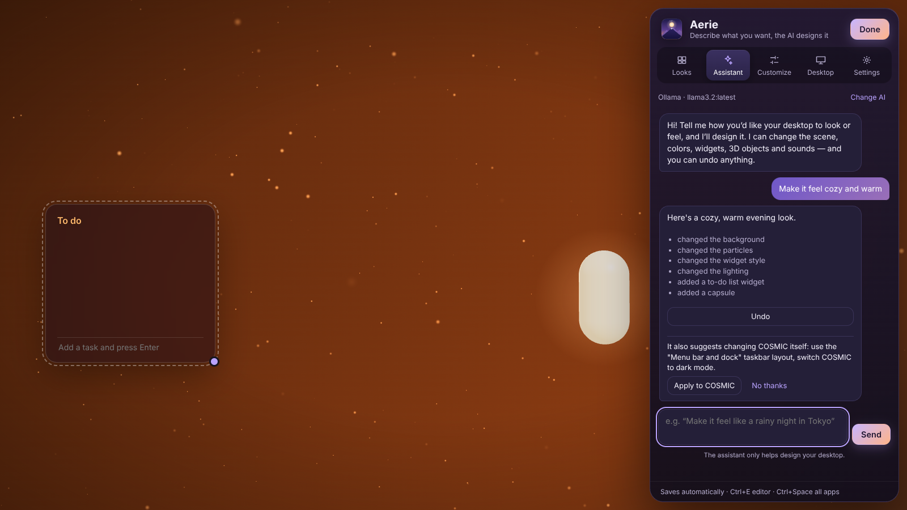

# Aerie

A living 3D desktop for Pop!_OS (COSMIC), with an AI that helps you design it.

Aerie replaces your wallpaper with a living scene, like Wallpaper Engine: sunflowers swaying to the horizon, aurora over snowy peaks, a neon synthwave grid or a ringed planet in deep space. On top go widgets and an app launcher, the camera drifts with your mouse, and your windows stay on top as usual.


*Aerie was called Deskscape. Your setup, saved looks and pictures carry over automatically.*

## Install, update, uninstall

| | How |
| --- | --- |
| **Install** | `curl -fsSL https://jayswansocool48.github.io/aerie/install.sh \| bash` (or `./install.sh` in this folder). It also replaces Deskscape if you had it. |
| **Open** | Press **Super**, type **Aerie**, click its icon. |
| **Update** | Automatic with your other updates in the **COSMIC Store**, or Settings → **Check for updates**. |
| **Uninstall** | Aerie → Settings → **Uninstall Aerie** (removes the app and all its data, and puts COSMIC back how it was), the COSMIC Store, or `./install.sh --uninstall`. |
| **Not working?** | `./install.sh --check`, and send the output. |

Aerie is a regular Pop!_OS package, not a Flatpak: COSMIC only lets apps outside the Flatpak sandbox draw on the desktop layer, which a live wallpaper needs.

## Using it

Open Aerie and a panel appears on the right with five places:

| | |
| --- | --- |
| **Looks** | Five hand-made looks — Golden Meadow, Northern Lights, Neon Nights, Deep Space, Zen Garden — and looks you save yourself. |
| **Assistant** | Describe what you want ("cozy and warm", "a rainy night in Tokyo", "add a to-do list top left") and the AI designs it. Every change can be undone. |
| **Customize** | Background, widgets, 3D objects, camera, particles, lighting, fog, fields of flowers and sound — each one a card you open when you need it. |
| **Desktop** | Your real COSMIC panel and dock (layouts, applets, pinned apps, colors), frosted glass, window corners, and the lock screen (picture, message, clock, profile picture). Everything can be restored in one click. |
| **Settings** | Pausing, sounds (including your own files), updates, privacy, uninstall. |

On the desktop itself:

- **Right-click** for quick actions: add a widget where you clicked, change the look, move widgets, pause, mute, set the lock screen.
- **Hold Alt and drag** any widget to move it.
- **Ctrl+E** opens the panel, **Ctrl+Space** all your apps, **Esc** closes.
- Aerie **pauses** while the app you're using is maximized or anything is full screen, so games get full speed. It wakes as soon as your mouse is on the desktop.



## The design assistant

It only helps design your desktop — it won't answer other questions. Pick the AI it uses:

| | Cost | Privacy |
| --- | --- | --- |
| **Ollama** | Free | Runs on your computer; nothing leaves it. Install from [ollama.com](https://ollama.com), then `ollama pull llama3.2`. |
| **Claude** (Anthropic) | Pay as you go, with your own [API key](https://console.anthropic.com) | Your message and a short design summary are sent to Anthropic. |
| **ChatGPT** (OpenAI) | Pay as you go, with your own [API key](https://platform.openai.com) | Your message and a short design summary are sent to OpenAI. |

The design summary is colors, lighting, widget types and positions and 3D shapes — never your notes, to-dos, names, pictures or files. Keys are stored only on your computer. The assistant can only make the kinds of changes listed in `web/js/assistant.js`; every value is checked first, and changes to COSMIC itself need your click. See `PRIVACY.md`.

## What's inside

- `aerie/shell.py` — a GTK 4 surface per screen on COSMIC's desktop layer (via gtk4-layer-shell), showing a WebKitGTK page
- `aerie/server.py` — local server on `127.0.0.1` only, protected by a random per-run key
- `aerie/assistant.py` — talks to Claude, OpenAI or Ollama (keys stay here, never in the page)
- `aerie/desktop_watch.py` — reads COSMIC's window states to pause (tested in `tests/`)
- `aerie/cosmic_look.py`, `aerie/account.py` — COSMIC's panel, dock, glass, lock screen and profile picture, with backup and restore
- `web/` — the 3D scene (three.js), widgets, looks, sounds (synthesized in code) and the editor
- `tools/build-deb.sh` — builds the package with gtk4-layer-shell and the COSMIC Store listing

```bash
python3 -m aerie.server --port 8765   # the page only, in a normal browser
./bin/aerie                           # the whole app from this folder (run tools/build-deb.sh once for layer-shell)
python3 tests/test_desktop_watch.py   # window-state tests
```

**Releasing:** bump `aerie/__init__.py` and add a `<release>` to `data/io.github.jayswansocool48.Aerie.metainfo.xml`, then GitHub → **Actions → Release → Run workflow**. It builds the package, makes the release and publishes the signed package source the COSMIC Store updates from.

## Credits and licenses

- Aerie: MIT — see `LICENSE`
- [three.js](https://threejs.org) r169 (MIT) and [gtk4-layer-shell](https://github.com/wmww/gtk4-layer-shell) 1.3.0 (MIT), bundled with their licenses
- No bundled fonts or audio; sounds are synthesized in code; preset previews are screenshots of Aerie; the icon is original
- Optional 360° skies and models: [Poly Haven](https://polyhaven.com), CC0

See `PRIVACY.md`, `TERMS.md` and `COMPLIANCE.md`.
