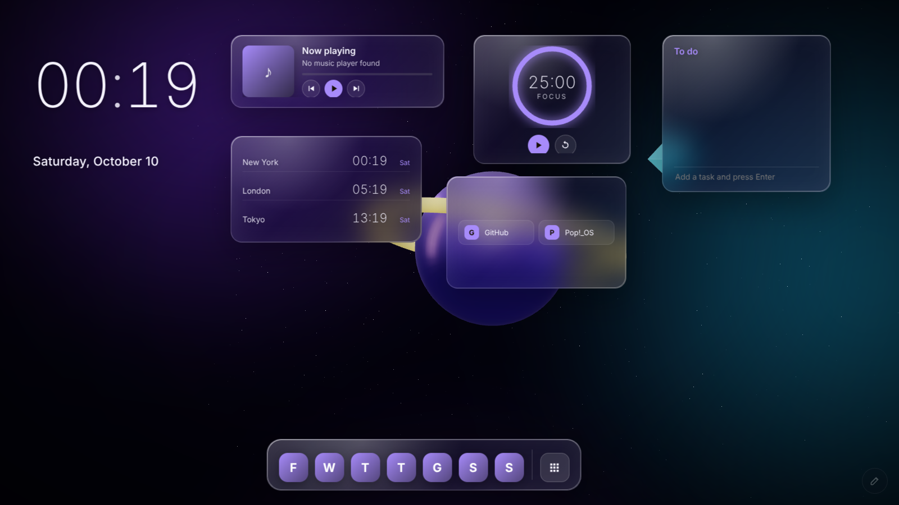
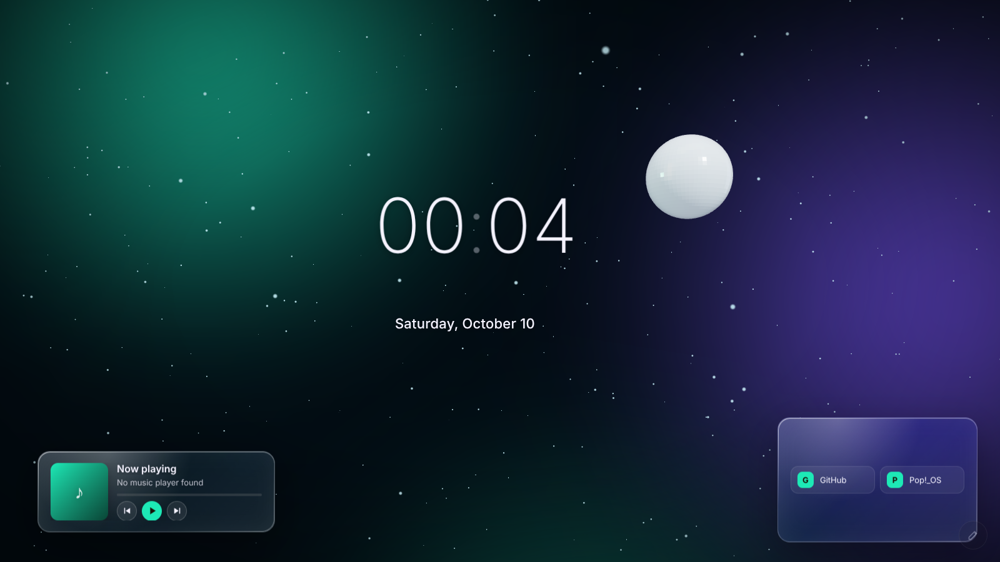
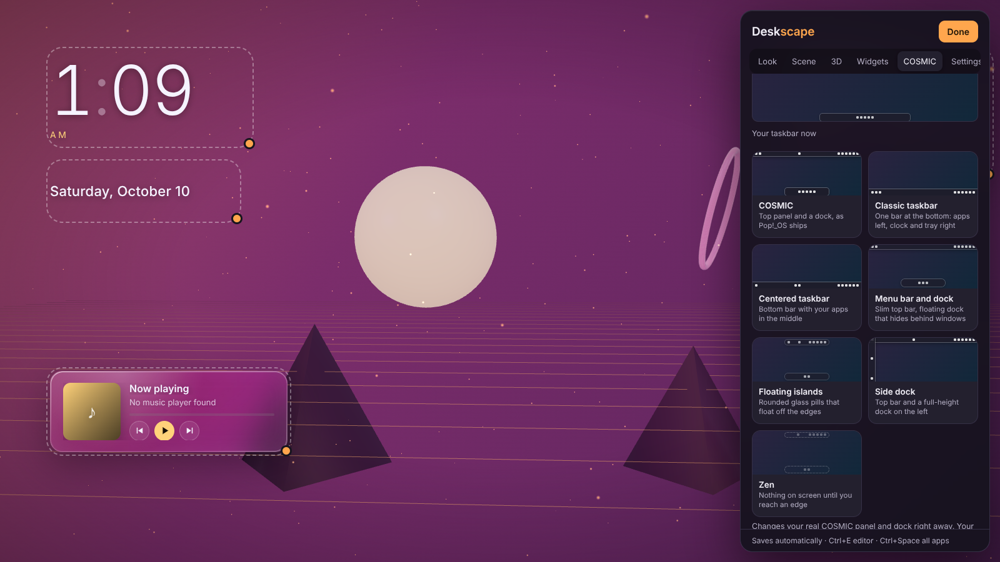
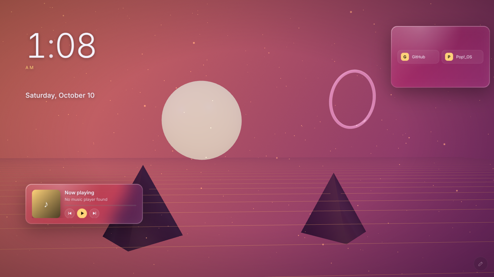

# Deskscape

A live 3D wallpaper for Pop!_OS (COSMIC), like Wallpaper Engine. It replaces your desktop wallpaper with a living scene: widgets and an app launcher, 3D objects you can spin, grab and click, a camera that moves with your mouse like a game's main menu, and ambient sound. It can also restyle COSMIC's **real taskbar** — the panel and dock themselves — and your **lock screen**. Like Wallpaper Engine, it **pauses** while you use apps. Your windows stay on top as usual.



## Install, update, uninstall

Deskscape is a regular Pop!_OS package, not a Flatpak: COSMIC only lets apps outside the Flatpak sandbox draw on the desktop layer, which a live wallpaper needs. Once installed it shows up in the **COSMIC Store** and its icon stays in your app list.

| | How |
| --- | --- |
| **Install** | `curl -fsSL https://jayswansocool48.github.io/Deskscape/install.sh \| bash` (or `./install.sh` in this folder) |
| **Open** | Press **Super**, type **Deskscape**, click its icon. It opens in front with the Customize panel; click **Done** and it settles in as your wallpaper, behind your windows. Opening it again brings the panel back. |
| **Update** | Automatic with your other updates in the COSMIC Store, or Settings → **Check for updates**. |
| **Not working?** | Run `./install.sh --check` and send the output. If it pauses when it shouldn't, `deskscape --windows` shows what it sees of your windows. |
| **Uninstall** | Deskscape → Settings → **Uninstall Deskscape** (removes the app, its icon and all its data), the COSMIC Store, or `./install.sh --uninstall`. |

## What you can do



- **20 presets** — Sunflower Field, Wildflower Meadow, Crystal Cove, Above the Clouds, Ember Sky, Milky Way (Sunflower Field and these three use real 360° skies), Aurora, Neon Grid, Sunset Drive, Sakura, Deep Ocean, Forest Mist, Rainy Window, Cyber HUD, Cozy Night, Galaxy, Zen Garden, Minimal Mono, Calm Paper, Blank. Each comes with its own soundscape and a matching style for your COSMIC taskbar (applied only if you say yes), and **Surprise me** picks one at random.
- **Mouse-driven camera** — parallax (slides like a game menu), orbit or fixed.
- **Right-click the desktop** for quick actions: add a widget where you clicked, change the look, move widgets, pause or resume, mute, set the lock screen, or open a widget's settings.
- **Move widgets without the editor** — hold **Alt** and drag any widget, or right-click → **Move widgets** to drag and resize them all.
- **My looks** — save what you made and switch back to it any time (Look tab or right-click → Change the look).
- **Your own sounds** — use your own files for clicks, opening apps, the timer chime and the background soundscape.
- **Fields** — sunflowers, wildflowers or tall grass stretching to the horizon and swaying in the wind, for any scene.
- **Widgets move your way** — drift with the camera at their own depth, stay perfectly still, or turn in **3D** like the panels of a game menu (for all widgets or one at a time).
- **360° skies** — real panoramas all around the scene that you look around in with the mouse, and that light and reflect in the 3D objects. Pick from Poly Haven's free library or use your own 360° photo (.jpg, .png or .hdr).
- **Free 3D models** — add models from Poly Haven's library in one click, or your own `.glb`.
- **Pauses like Wallpaper Engine** — stops completely while the app you're using is maximized, or anything is full screen (or, if you like, whenever you're using any app), so games and apps get your computer's full speed. Minimized and background apps never pause it, each screen pauses on its own, and moving your mouse onto the wallpaper always wakes it.
- **Normal taskbar while maximized** — turns on COSMIC's own setting that makes the panel and dock solid and attached while a window is maximized (per bar, in the COSMIC tab).
- **Lock screen designer** — make COSMIC's lock screen a picture of your current scene (with or without widgets, darkened for readability, with your own message) or any picture; pick a 12- or 24-hour clock and change your profile picture. A preview shows how it will look, and **Lock now** shows the real thing.
- **3D objects** — 11 shapes or **your own `.glb` model**, in matte, glossy, metal, glass, cartoon, wireframe, glowing or hologram. Objects can spin, float, be **grabbed and spun**, react to hover, look at the mouse, and open an app, a website or the app drawer when clicked.
- **22 widgets**
  - Time: clock (digital or analog), date, world clocks, countdown, calendar, focus timer (pomodoro with a chime)
  - Apps: **dock** with magnification, app launcher (grid or list, categories, search, recently used), favorites, search bar, quick links
  - Info: system monitor (incl. network speed), live CPU/memory/network graph, **now playing** with controls (Spotify, browsers, any MPRIS player), moon phase
  - Personal: greeting, notes, to-do list, quotes, text, image, photo slideshow
- **App drawer** — a full-screen glass launcher with search and categories. Open it from the dock, a hot corner, a 3D object, or **Ctrl+Space**. Star any app to pin it to your dock.
- **Widget styles** — frosted glass, **liquid glass** (with a highlight that follows your mouse), solid, outline, neon or no card; per-widget overrides, fonts, accent, blur, roundness, 3D tilt and entrance animations.
- **Backgrounds** — animated aurora, flowing colors, gradients, images, looping videos, or see-through to your COSMIC wallpaper; plus vignette and film grain.
- **Particles** — dust, twinkling stars, fireflies, snow, rain and bubbles; fog, lighting and a neon floor grid.
- **Your real COSMIC taskbar** (optional) — Deskscape edits COSMIC's own panel and dock, not a copy:
  - **7 taskbar layouts** in one click: COSMIC, Classic taskbar (one bottom bar), Centered taskbar, Menu bar and dock, Floating islands, Side dock and Zen (everything hides)
  - **Applets**: add, remove and reorder what's on each bar (clock, system tray, app list, workspaces, launcher, sound, network, battery, notifications, power… and any third-party COSMIC applet you have installed), left, middle or right
  - **Pinned apps** on the dock or taskbar, in order, or copied from your Deskscape dock
  - Show or hide the panel and dock, position, size, color (theme, dark, light or any color), opacity, auto-hide, floating, stretch, roundness, margin, padding and spacing
- **COSMIC glass and windows** (optional) — turn on COSMIC's **frosted glass windows**, panel, dock and menus, set blur strength, window corners, gaps and border, dark or light mode.
- Your original COSMIC setup is saved before the first change; **Restore my original COSMIC look** puts it all back, and deleting your data or uninstalling Deskscape does too.
- **Sound** — soft interface sounds (glass bells, muted or 8-bit retro) for clicks, opening the drawer and launching apps, a chime for the focus timer, and **10 ambient soundscapes**: rain, ocean waves, wind, fireplace, forest birds, deep space, cyber hum, wind chimes and night crickets. Ambient sound is off until you turn it on, fades out while music or a video plays, and plays from one screen only. Every sound is generated live in code; no audio files.





## Using it

| Action | How |
| --- | --- |
| Customize | Pencil button (bottom-right), **Ctrl+E**, or open Deskscape again from the app list |
| All apps | **Ctrl+Space**, the dock's grid button, or a hot corner (Settings) |
| Pin an app to the dock | Hover it in the launcher and click the star |
| Move / resize widgets | Hold **Alt** and drag a widget, or right-click → Move widgets (drag; orange corner resizes; Shift snaps) |
| Move / resize 3D objects | In the editor, drag an object; scroll on it to resize |
| Spin an object | Outside the editor, grab it with the mouse |
| Delete selected item | **Delete** in the editor |
| Close the editor | **Esc** or **Done** |
| Change your taskbar | Editor → COSMIC → pick a layout, then fine-tune the panel, dock, applets and pinned apps |
| Sounds | Editor → Settings → Sound and presets (soundscape per scene in Scene → Soundscape) |
| Pausing | Editor → Settings → Pause the wallpaper: when a window is maximized (default), while you use any app, or never |
| Lock screen | Editor → COSMIC → Lock screen → Use my current scene (press Super+Escape to see it) |
| 360° sky | Editor → Look → Background → 360° sky or photo |
| Start at login | Settings → "Start Deskscape when I log in" |
| Quit | Settings → Quit, or right-click the app icon → Quit |

## How it works

- `deskscape/shell.py` — a GTK 4 surface per monitor on COSMIC's desktop layer (above the normal wallpaper, below your windows) via gtk4-layer-shell, showing a WebKitGTK page
- `deskscape/server.py` — local server on `127.0.0.1` only, protected by a random per-run key: saves your setup, lists installed apps, opens them, reads system stats, updates and uninstalls
- `deskscape/cosmic_look.py` — reads and changes COSMIC's own settings (glass, windows, the panel and dock with their applets, and pinned apps) with backup and restore
- `deskscape/media_player.py` — now-playing info and controls over MPRIS
- `deskscape/package.py` — how Deskscape is installed, and the update/uninstall commands
- `web/` — the 3D scene (three.js), widgets, app drawer, presets, taskbar layouts (`taskbar.js`), sounds (`sound.js`, Web Audio) and editor
- `tools/build-deb.sh` — builds the package, bundling gtk4-layer-shell (Pop!_OS 24.04 doesn't ship it) and the COSMIC Store listing; `data/` holds the app-list icon, desktop entry and store text

### Developing

```bash
python3 -m deskscape.server --port 8765   # the page only, in a normal browser
./bin/deskscape                           # the whole app from this folder (run tools/build-deb.sh once for layer-shell)
```

### Releasing

1. Bump the version in `deskscape/__init__.py` and add a `<release>` to `data/io.github.jayswansocool48.Deskscape.metainfo.xml`.
2. GitHub → **Actions → Release → Run workflow** (or `git pull && git tag vX.Y.Z && git push origin vX.Y.Z`; a tag that doesn't match the version is refused) — GitHub Actions builds the package, attaches it to a Release and publishes the signed package source. Installed copies then update through the COSMIC Store.

## Credits and licenses

- Deskscape: MIT — see `LICENSE`
- [three.js](https://threejs.org) r169 (MIT), bundled in `web/vendor/` with its license
- [gtk4-layer-shell](https://github.com/wmww/gtk4-layer-shell) 1.3.0 (MIT), bundled in the package
- No bundled fonts or audio; the only bundled images are preset previews (screenshots of Deskscape); the icon is original and all sounds are synthesized in code
- 360° skies and 3D models from the online library: [Poly Haven](https://polyhaven.com), CC0 (public domain), downloaded only when you pick them

See `PRIVACY.md`, `TERMS.md` and `COMPLIANCE.md`.
